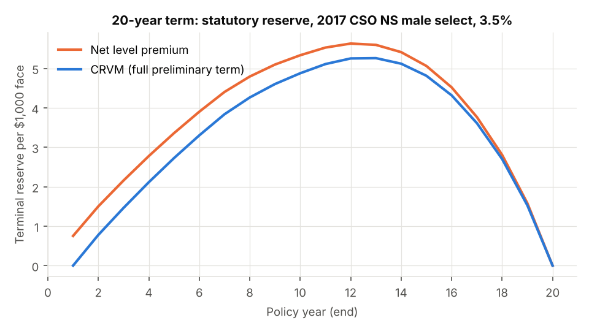
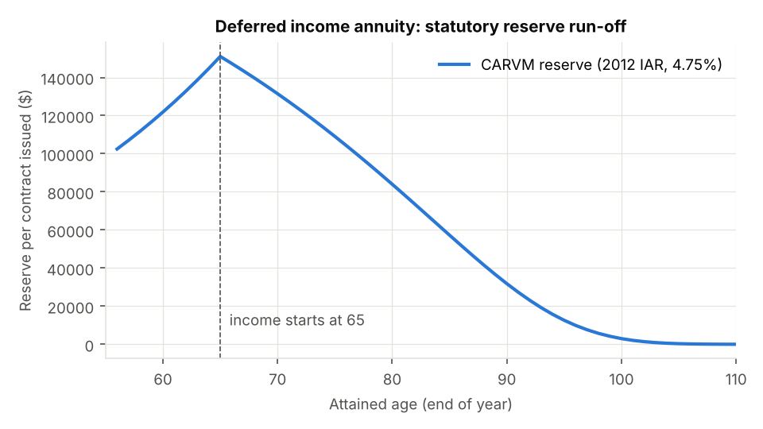
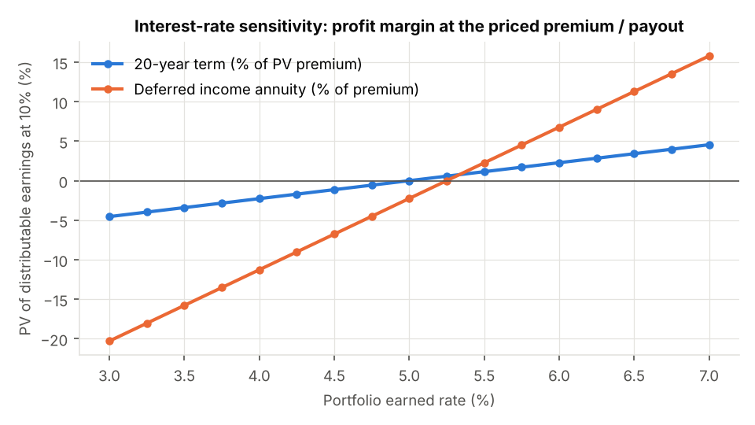
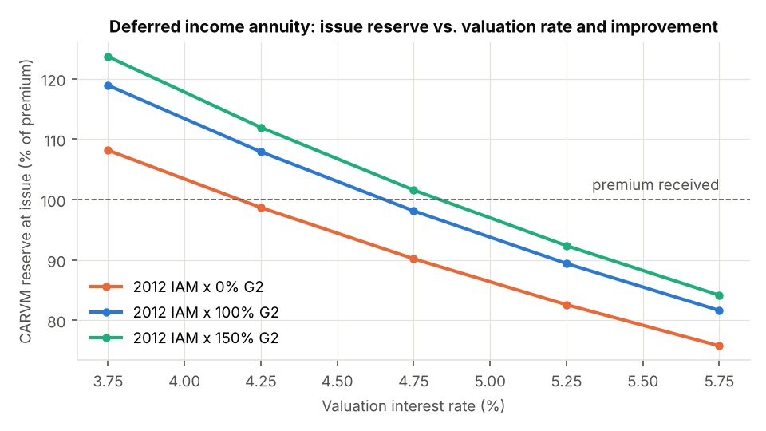

# Life & Annuity Pricing and Reserving Model

A Python model that prices two contracts using SOA mortality tables, projects their cash flows, calculates statutory-style reserves, and stress-tests the results:

| Product | Pricing mortality | Statutory valuation basis | Reserve method |
|---|---|---|---|
| **20-year level term life**: male 35 nonsmoker, $500,000 face | 70% of 2017 Loaded CSO NS male, select & ultimate | 2017 CSO NS male select & ultimate, 3.5% | NLP and CRVM (with the 20-pay-life expense allowance cap), plus a deficiency reserve test |
| **Single-premium deferred income annuity**: male 55, $100,000, life income from 65, return of premium on death before 65 | 2012 IAM basic × Scale G2, generational | 2012 IAR (2012 IAM × G2 generational), 4.75% | CARVM |

The actuarial core follows the annual, curtate framework in *Actuarial Mathematics for Life Contingent Risks* (ALTAM). It is checked against ALTAM's published Standard Ultimate Survival Model values before any product is priced.

```bash
pip install -r requirements.txt
python run_model.py        # writes outputs/: CSVs, Excel workbook, charts, summary.md
python -m pytest -q        # 14 tests: ALTAM values, table parsing, reserve recursions, pricing
```

---

## Headline results

**20-year term.** The gross premium that gives a 10% IRR on distributable earnings is **$617.21 a year ($1.234 per $1,000)**. The CRVM reserve is the full preliminary term reserve (α = $0.174, β = $0.955 per $1,000). It peaks at **$5.26 per $1,000** in year 12. No deficiency reserve is needed, because the gross premium exceeds β.

**Deferred income annuity.** The life income that gives a 10% IRR is **$10,821 a year, a 10.82% payout rate**. The CARVM reserve at issue is 98.1% of the premium and peaks at $157,568 at age 65, when income starts.




### Sensitivities (price held at base, from `outputs/summary.md`)

| 20-year term | IRR | Change (bp) | Premium needed to restore 10% |
|---|---|---|---|
| Base | 10.00% | – | $617.21 |
| Mortality 110% | 8.73% | −127 | +4.2% |
| Mortality 120% | 7.35% | −265 | +8.3% |
| Expenses 110% | 8.86% | −114 | +4.0% |
| Earned rate −100bp | 8.89% | −111 | +3.7% |
| Lapses 125% | 9.82% | −18 | +0.6% |
| Valuation rate −50bp | 9.97% | −3 | +0.1% |

| Deferred income annuity | PV of DE at 10% (% of premium) | Change (bp) | Payout rate needed to restore 10% |
|---|---|---|---|
| Base | 0.00% | – | 10.82% |
| Earned rate −100bp | −9.02% | −902 | 9.58% (−125bp) |
| Valuation rate −50bp | −2.64% | −264 | 10.43% (−39bp) |
| 150% of Scale G2 | −0.88% | −88 | 10.69% (−13bp) |
| Mortality 90% (longevity) | −0.45% | −45 | 10.75% (−7bp) |
| No mortality improvement | +2.15% | +215 | 11.17% (+35bp) |





### What the numbers say

* **Term life is a mortality and expense business.** A 10% rise in mortality costs about 127bp of IRR. The first-year commission (90% of premium) creates a strain that takes until year 10 to recover. Valuation interest barely matters, because term reserves are small: a 50bp change moves IRR by about 3bp.
* **The deferred annuity is a spread business.** 100bp of earned rate is worth about 9% of premium in PV of profit, ten times any mortality shock. Longevity risk shows up mainly through the improvement scale: removing improvement is worth 215bp of margin, while 150% of G2 costs 88bp.
* **The valuation rate drives annuity strain.** At 4.75% the CARVM reserve is just under the premium. At 4.25% it is 107.9%, so the contract has to be funded with surplus at issue. That is why statutory valuation rates matter so much for annuity writers.
* **IRR is not always defined for annuities.** With little issue strain, a longevity or valuation shock can turn later-year earnings negative. The cash flows then change sign several times and the IRR is no longer unique. `profit.irr` returns NaN in that case, and the annuity results lead with PV of distributable earnings at the hurdle rate. This is a known weakness of IRR as a pricing measure for spread products.

---

## Engine validation against ALTAM

The Standard Ultimate Survival Model (Makeham, A = 0.00022, B = 2.7×10⁻⁶, c = 1.124) is coded in `lamodel/tables.py`. Below, the engine's results are compared with ALTAM's published tables at 5% interest (l₂₀ = 100,000):

| Age | l_x model | l_x ALTAM | ä_x model | ä_x ALTAM | A_x model | A_x ALTAM |
|---|---|---|---|---|---|---|
| 20 | 100,000.0 | 100,000.0 | 19.9664 | 19.9664 | 0.04922 | 0.04922 |
| 50 | 98,576.4 | 98,576.4 | 17.0245 | 17.0245 | 0.18931 | 0.18931 |
| 60 | 96,634.1 | 96,634.1 | 14.9041 | 14.9041 | 0.29028 | 0.29028 |
| 65 | 94,579.7 | 94,579.7 | 13.5498 | 13.5498 | 0.35477 | 0.35477 |

The tests also check that the model is internally consistent:

* **Reserve recursions.** For every year, (ₜV + P)(1+i) = q·b + p·ₜ₊₁V holds for the NLP and CRVM term reserves, and the equivalent payout-annuity recursion holds for the DIA CARVM reserve.
* **Insurance–annuity identity.** A_{x:n} = 1 − d·ä_{x:n} holds.
* **2012 IAR construction.** Each rate equals q₂₀₁₂(x) · (1 − G2(x))^(year − 2012).

---

## Methodology

### Mortality (`lamodel/tables.py`)
* `data/soa/` holds the SOA XTbML files exactly as published on mort.soa.org. A small parser reads them, with no external dependency:
  * t3291 / t3292: 2017 Loaded CSO Smoker Distinct Nonsmoker, male and female, ANB, 25-year select and ultimate
  * t2581 / t2582: 2012 IAM Basic Table, male and female, ANB
  * t2583 / t2584: Projection Scale G2, male and female
* Every basis reduces to one vector of one-year death probabilities from the issue age. Pricing, valuation and stressed bases can therefore be swapped without touching product code. `ScaledBasis` applies percentage-of-table adjustments, and `GenerationalTable` applies improvement scales with a multiplier for longevity stress.

### Actuarial functions (`lamodel/actuarial.py`)
Survival, discounting, annuities-due (temporary and deferred), term, whole life and endowment insurance, and life expectancy. All are annual and curtate. Deaths are paid at the end of the year; premiums and annuity payments are made at the start of the year.

### Reserves (`lamodel/reserves.py`)
* **NLP.** ₜV = A¹_{x+t:n−t} − P·ä_{x+t:n−t}, on the valuation basis.
* **CRVM.** The first-year net premium α is c_x, and the renewal net premium is β. The expense allowance β − α is capped at the 19-payment life renewal net premium at age x+1, minus c_x, following the Standard Valuation Law. For level term the cap does not bind, so the model reports FPT. The same code handles products where it does bind.
* **Deficiency reserve.** If the gross premium is less than β, the model adds (β − G)·ä for the remaining premium period.
* **CARVM (DIA).** The contract has no cash surrender value, so the only benefit stream the holder can elect is the contractual one. The CARVM reserve is therefore the PV of future guaranteed benefits on 2012 IAR at the valuation rate: the return-of-premium death benefit during deferral plus the deferred life income.

### Projection and profit test (`lamodel/term_life.py`, `lamodel/deferred_annuity.py`)
The projection is annual and covers one policy issued at time 0. Each year includes:
* **Decrements.** In-force counts, deaths, lapses (term only) and expiry.
* **Cash flows.** Premiums, commissions, premium tax and per-policy expenses (with acquisition costs and inflation), claims and annuity income.
* **Investment income.** Earned on the opening reserve plus net start-of-year cash flow.
* **Results.** Statutory reserve change, pre-tax statutory gain, then tax at 21%.
* **Required capital.** A simplified RBC-style factor: 0.10% of net amount at risk plus 2% of reserves for term, and 4% of reserves for the DIA.
* **Distributable earnings.** After-tax gain minus the increase in required capital, plus after-tax interest on that capital.

Pricing solves, by bisection, for the term premium or DIA income that makes the PV of distributable earnings at the 10% hurdle equal zero. That is the same as setting IRR equal to the hurdle.

### Sensitivity (`lamodel/sensitivity.py`)
Every scenario is run two ways:
* **At the base price**, showing the change in IRR and PV of profit.
* **Repriced**, showing the premium or payout rate that restores the hurdle.

The scenarios are:
* earned rate ±100bp
* valuation rate ±50bp
* mortality 90%, 110% and 120% for term, and 90% and 110% for the DIA
* lapses 75% and 125% (term)
* mortality improvement at 0% and 150% of G2 (DIA)
* expenses 110%

The model also produces margin-versus-earned-rate curves from 3% to 7%, and reserve grids across valuation interest, mortality and improvement.

### Base assumptions
All assumptions are fields on `TermAssumptions` and `DIAAssumptions`. The defaults are illustrative, not company experience:

| | Term | DIA |
|---|---|---|
| Earned rate | 5.00% | 5.25% |
| Commission | 90% first year, 5% years 2–10, 2% after | 3% of premium |
| Acquisition expense | $300 + $1 per $1,000 | $350 |
| Maintenance expense | $75 a year, inflating 2.5% | $60 a year, inflating 2.5% |
| Premium tax | 2% | – |
| Lapse rates | 8%, 6%, 5%, then 4% (years 4–10) and 3% (years 11–20) | none (no surrender) |
| Hurdle rate | 10% | 10% |

---

## Outputs

| File | Contents |
|---|---|
| `outputs/summary.md` | Every metric and sensitivity table |
| `outputs/life_annuity_model.xlsx` | Assumptions, year-by-year projections, sensitivity and reserve grids (12 sheets) |
| `outputs/term_projection.csv`, `outputs/dia_projection.csv` | Full cash-flow projections |
| `outputs/*.png` | Charts |

## Simplifications and possible extensions

* **Valuation framework.** Reserves use the formula-based Standard Valuation Law methods. Principles-based reserving is not modelled: neither the VM-20 NPR/DR/SR for term (required for new term business) nor VM-22 for non-variable annuities. Nor are Regulation XXX segmentation or X-factors. The valuation interest rates are inputs and should be set to the rates prescribed for the issue year.
* **Timing.** The model is annual with curtate timing: no monthly premiums or mid-year deaths, and terminal rather than mean reserves.
* **Tax.** Tax is charged at 21% on statutory gain. There are no tax reserves, DAC tax or loss carryforward limits.
* **Investments.** The earned rate is a single flat rate. There is no asset model, ALM or interest-rate scenario generator. A stochastic or VM-20-style scenario set would be the natural next step.
* **Mortality.** There is no post-level-term shock lapse or anti-selection (the term product simply expires at year 20), and no preferred-class structure.

## Data source
Mortality tables are from the Society of Actuaries Mortality and Morbidity Table Repository ([mort.soa.org](https://mort.soa.org)). They are reproduced unmodified in XTbML format, and each file's `TableReference` element cites the original report.
