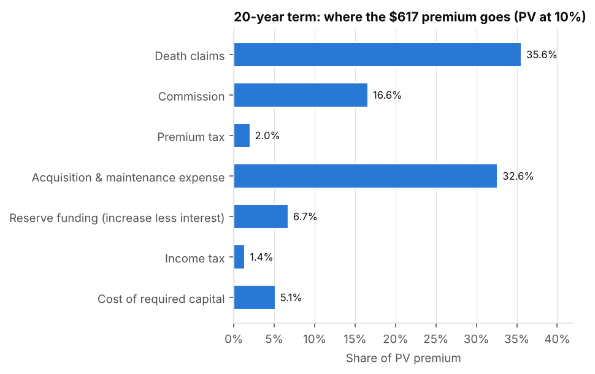
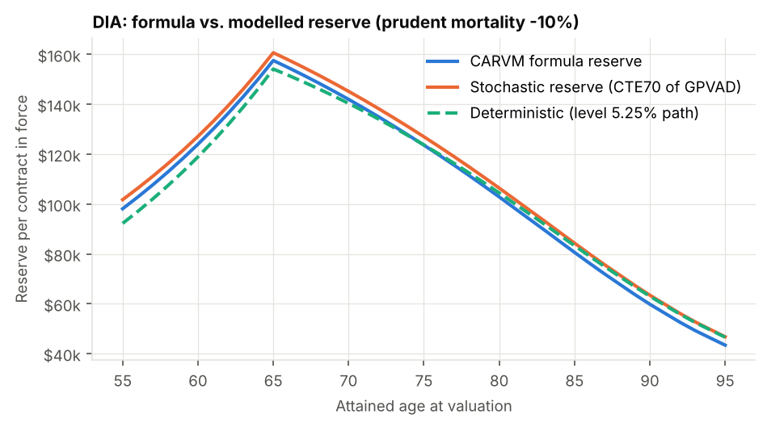
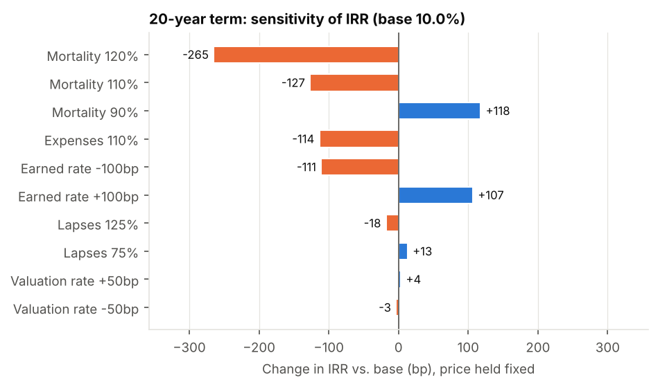
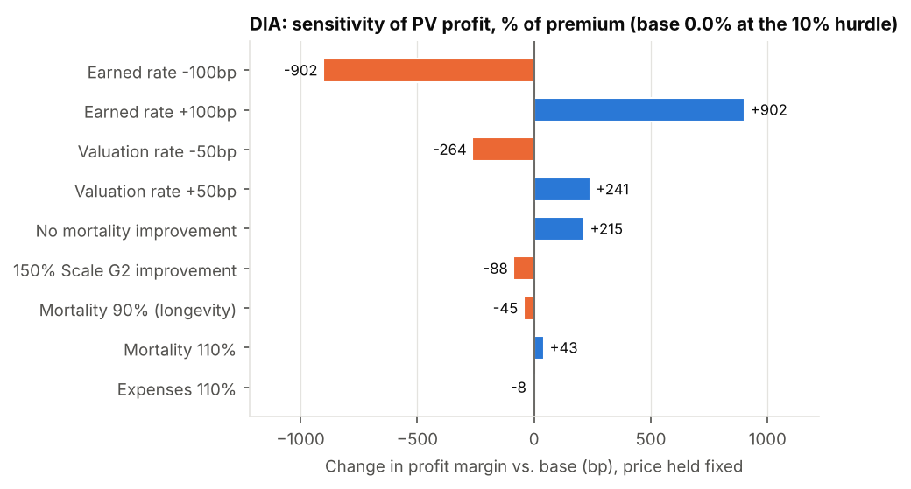
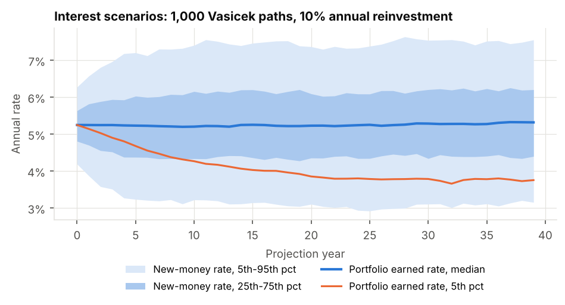
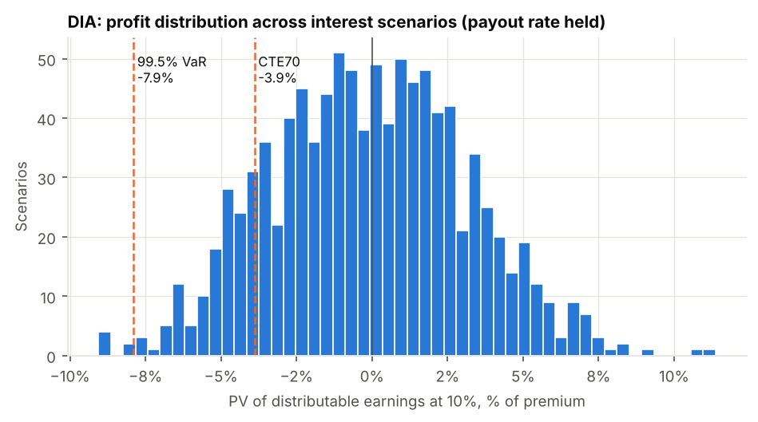
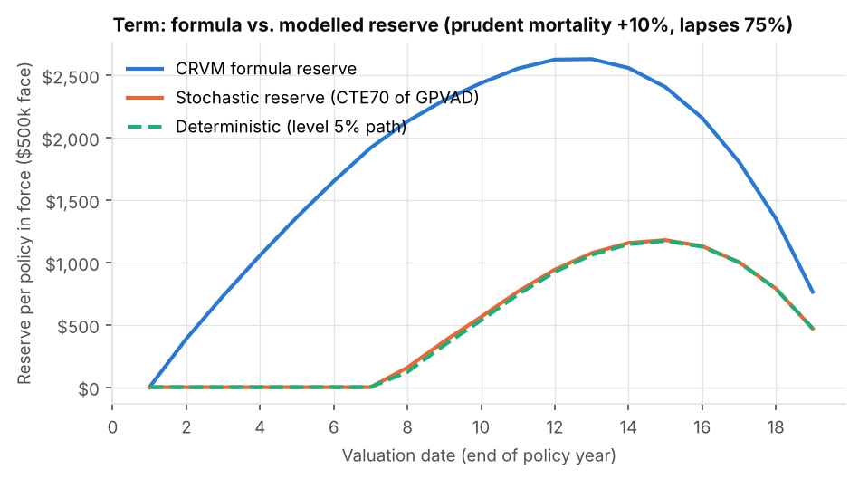
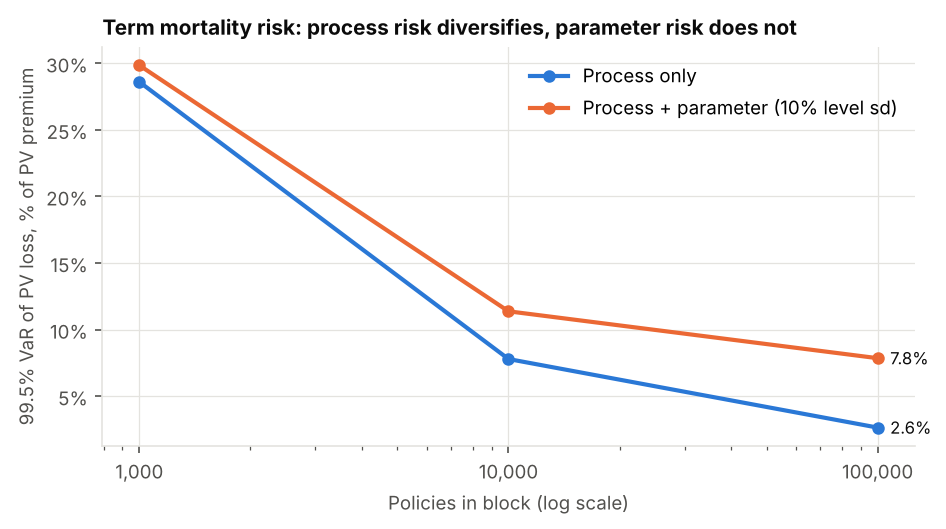
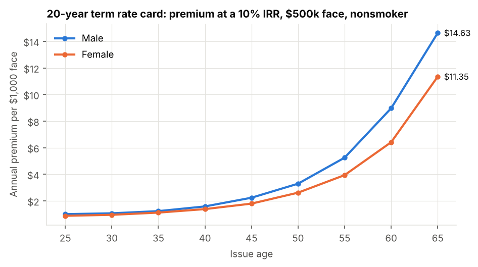
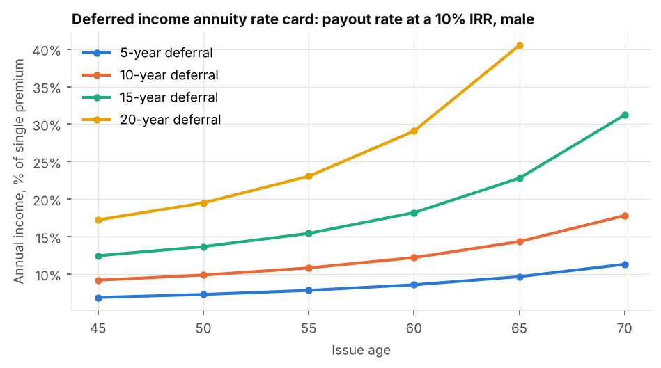

# Life & Annuity Pricing and Reserving Model

[](https://github.com/richterrw/Life-and-annuity-pricing-and-reserving-model/actions/workflows/ci.yml)


This repository is a working pricing and valuation model for two US individual products, built on official **SOA mortality tables**:

- **20-year level term life**, priced on the 2017 CSO select & ultimate table.
- **Single-premium deferred income annuity (DIA)**, priced on the 2012 IAM table with Scale G2 projected generationally (the 2012 IAR).

For each product the model covers:
- **Pricing:** the premium or payout rate that delivers a 10% hurdle IRR.
- **Projection and profit test:** a statutory cash-flow projection through tax, required capital and distributable earnings.
- **Formula reserves:** NLP, CRVM and deficiency reserves for term, and CARVM for the annuity.
- **Stochastic reserve:** a VM-20/VM-22-style reserve, the CTE70 of the greatest present value of accumulated deficiencies (GPVAD), over 1,000 interest-rate scenarios.
- **Risk analysis:** deterministic sensitivities, rate cards, a premium build-up, and a Monte Carlo mortality study separating process risk from parameter risk.

**Validation:** the actuarial engine reproduces published ALTAM values exactly before any product is priced. 25 tests tie every reserve to its recursion, and the stochastic engine reproduces the formula reserve on the statutory basis.

```bash
pip install -e ".[dev]"
python run_model.py          # ~15s: writes outputs/ (Excel workbook, 12 CSVs, 16 charts, summary.md)
pytest -q                    # 25 tests
```

**Start here:**
- [`notebooks/walkthrough.ipynb`](notebooks/walkthrough.ipynb): guided tour with live results
- [`outputs/life_annuity_model.xlsx`](outputs/life_annuity_model.xlsx): formatted workbook, executive summary first
- [`docs/methodology.md`](docs/methodology.md): every formula

---

## Results at a glance

| | **20-year term** (male 35 NS, $500k) | **Deferred income annuity** (male 55, $100k, income from 65) |
|---|---|---|
| Price at a 10% IRR | **$617.21 a year** ($1.234 per $1,000) | **$10,821 a year** (10.82% payout rate) |
| Where the money goes | Claims 36%, expenses 33%, commission 17%, capital and reserve cost 12% | Benefits 89%, expenses and commission 5%, **margin 5.9%** |
| Formula reserve | CRVM = full preliminary term; peak $5.26 per $1,000 (year 12) | CARVM 98.1% of premium at issue; peak $157.6k at 65 |
| Stochastic reserve (CTE70) | Well **below** CRVM at every duration | 101.8% of premium, **above** CARVM |
| Dominant risk | Mortality: +10% costs **−127bp** of IRR | Interest: −100bp earned rate costs **9.0% of premium** |
| Tail risk | 10k-policy block, 99.5% VaR of PV loss = 11.4% of PV premium | CTE98 of PV loss = 7.4% of premium |

<table>
<tr>
<td></td>
<td></td>
</tr>
<tr>
<td></td>
<td></td>
</tr>
<tr>
<td></td>
<td></td>
</tr>
<tr>
<td></td>
<td></td>
</tr>
<tr>
<td></td>
<td></td>
</tr>
</table>

## What the model shows

1. **Term life is a mortality and expense business.**
   - A 10% rise in mortality costs 127bp of IRR, and 10% more expense costs 114bp. A ±100bp move in the earned rate is worth about ±110bp.
   - The 90% first-year commission creates a strain that takes until year 10 to repay.
   - The valuation interest rate barely matters (±3bp), because term reserves are small.
2. **The deferred annuity is a spread business.**
   - 100bp of earned rate is worth 9% of premium in PV of profit, roughly ten times any mortality shock.
   - Restoring the hurdle after a 100bp rate fall means cutting the payout rate by 125bp.
3. **Longevity risk sits in the improvement scale, not the base table.**
   - Removing Scale G2 improvement adds 215bp of margin, and 150% of G2 costs 88bp.
   - A flat 10% mortality reduction costs only 45bp, because most of the reserve is held for decades of payments the scale controls.
4. **The valuation rate drives annuity strain.**
   - At 4.75% the CARVM reserve is 98% of premium. At 4.25% it is 108%, so the company funds the difference from surplus at issue.
5. **Formula reserves are conservative for term but not for the annuity.**
   - For term, the stochastic reserve is a fraction of CRVM and is zero in the early durations. This is the redundancy that principles-based reserving released for the industry.
   - For the annuity, reinvestment risk pushes the CTE70 reserve above CARVM. Later in the payout period, prudent mortality and expenses also lift the deterministic reserve above it.
6. **Parameter risk dominates for large blocks.**
   - Process risk from random deaths diversifies as 1/√N: the 99.5% VaR falls from 29% of PV premium at 1,000 policies to 2.6% at 100,000.
   - A 10% uncertainty in the mortality level does not diversify, and keeps the 100,000-policy VaR at 7.9%. This is why experience studies and credibility matter more than scale.
7. **IRR is not always defined for annuities.**
   - With little issue strain, a shock can turn later earnings negative and give multiple IRRs. The model reports an IRR only when it is unique, and judges the annuity on PV of profit.

## Validation

| Check | Result |
|---|---|
| ALTAM Standard Ultimate Survival Model at 5%: $l_x$, $\ddot a_x$, $A_x$ at ages 20, 50, 60 and 65 | Matches the published tables (e.g. $\ddot a_{65}$ = 13.5498, $A_{60}$ = 0.29028) |
| NLP and CRVM reserve recursions, every year | Exact, to 1e-12 |
| DIA CARVM recursion through deferral and payout | Exact |
| GPVAD on the valuation basis with a level path at $i_v$ | Equals the CARVM reserve exactly |
| Level-path scenarios through the stochastic profit test | Reproduces the deterministic PV of profit |
| Premium build-ups | Components sum to 100% of PV premium |
| Vasicek simulation | Matches the analytic mean and variance |
| Mortality simulation | Mean equals the expected-value projection; coefficient of variation scales as 1/√N |
| 2012 IAR construction | Equals $q^{2012}_x(1-G2_x)^{y-2012}$ |

## Model structure

```
lamodel/
  tables.py            SOA XTbML parser; select & ultimate, generational and Makeham tables
  actuarial.py         survival, annuities, insurances (annual, curtate)
  reserves.py          NLP, CRVM (with 20-pay-life cap), deficiency reserve, CARVM
  term_life.py         20-year term: projection (vectorized), profit test, pricing
  deferred_annuity.py  deferred income annuity: projection, profit test, pricing
  profit.py            NPV, IRR (with a uniqueness check), solver, breakeven
  sensitivity.py       deterministic shocks, reserve grids, earned-rate curves
  stochastic.py        Vasicek generator, portfolio yield, GPVAD, CTE/VaR, block simulation
  analysis.py          rate cards, premium build-up, stochastic studies
  charts.py, excel.py  report output
  validation.py        ALTAM SUSM benchmark
run_model.py           command-line runner (--scenarios, --sims, --seed, --quick)
data/soa/              SOA tables exactly as published (XTbML)
tests/                 25 tests
notebooks/             executed walkthrough and its build script
docs/methodology.md    formulas and design notes
```

All assumptions are fields on `TermAssumptions` and `DIAAssumptions`. For example, `TermAssumptions().with_(issue_age=45, mortality_pct=0.8)` gives a new basis. Pricing, valuation and stress bases are separate, so a shock never leaks into the statutory reserve unless it is meant to.

## Key assumptions (illustrative, not company experience)

| | 20-year term | Deferred income annuity |
|---|---|---|
| Pricing mortality | 70% of 2017 Loaded CSO NS select & ultimate | 100% of 2012 IAM × Scale G2, generational from 2012 |
| Valuation basis | 100% 2017 CSO select, 3.50% | 2012 IAR, 4.75% |
| Earned rate | 5.00% | 5.25% |
| Lapse rates | 8%, 6%, 5%, then 4% (years 4–10) and 3% (years 11–20) | None (no surrender value) |
| Commission | 90% first year, 5% years 2–10, 2% after | 3% of premium |
| Expenses | $300 + $1 per $1,000 at issue; $75 a year, inflating 2.5% | $350 at issue; $60 a year, inflating 2.5% |
| Tax and capital | 21% tax; capital of 0.10% of net amount at risk + 2% of reserve | 21% tax; capital of 4% of reserve |
| Hurdle rate | 10% | 10% |
| Stochastic reserve margins | Mortality +10%, lapses at 75% | Mortality −10% |
| Interest scenarios | Vasicek short rate, 10-year new money + spread, 10% annual reinvestment, 1,000 paths | same |

## Scope and next steps

- **Valuation framework.** Formula reserves follow the Standard Valuation Law. The stochastic reserve implements the GPVAD/CTE mechanics of VM-20/VM-22, but not the regulatory requirements: no prescribed generator, asset model, exclusion tests, VM-20 NPR or Regulation XXX.
- **Projection detail.** The projection is annual and curtate, tax is a flat 21% on statutory gain, and there is no ALM or hedging.
- **Natural extensions:**
  - a VM-20 NPR for term;
  - dynamic, interest-sensitive lapses for a fixed deferred annuity with surrender charges;
  - a multi-factor or arbitrage-free generator with a real asset portfolio;
  - an actual-to-expected experience study feeding the pricing basis.

## Data

Mortality tables are from the Society of Actuaries Mortality and Morbidity Table Repository ([mort.soa.org](https://mort.soa.org)). They are reproduced unmodified in XTbML format, and each file's `TableReference` cites the source report. The included tables are:
- 2017 CSO Smoker Distinct Nonsmoker, male and female, ANB (tables 3291 and 3292)
- 2012 IAM Basic, male and female (tables 2581 and 2582)
- Projection Scale G2, male and female (tables 2583 and 2584)
